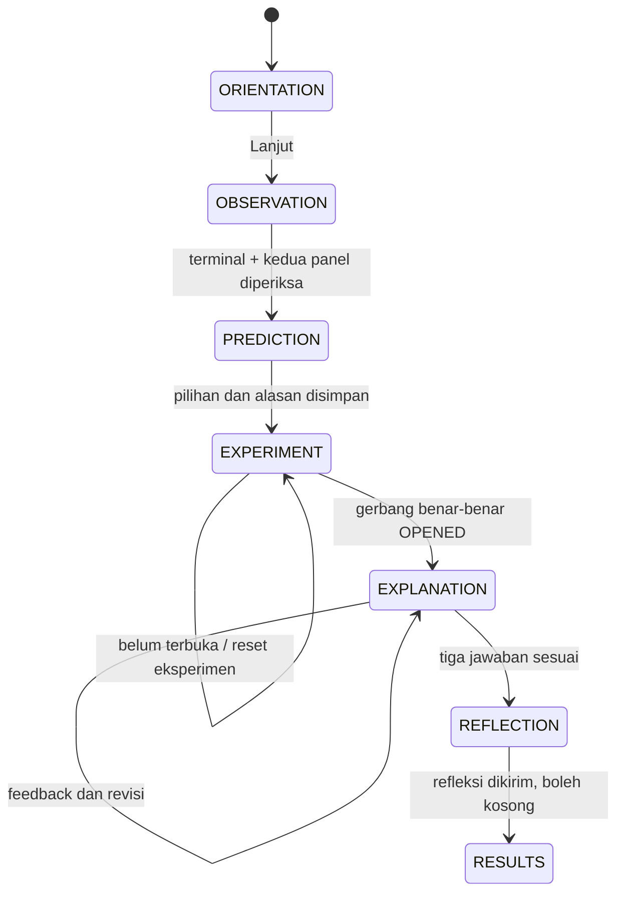

# Tahap 6 — Alur Pembelajaran dan Umpan Balik

Catatan Tahap 7: alur dan struktur belajar di dokumen ini tetap digunakan. Pernyataan penyimpanan memori pada riwayat Tahap 6 kini dilengkapi checkpoint lokal berversi; lihat STAGE_7.md. Kembali ke menu mempertahankan checkpoint untuk Lanjutkan, sedangkan Mulai/Ulang misi memulai sesi baru. Kehilangan fokus kini menunggu Lanjutkan secara eksplisit. Aturan konsep, kekekalan, prediksi dan revisi tidak diganti.

## Alur dan pembatasan

Status belajar disimpan terpisah dari status simulasi. `src/learning/session.ts` merupakan model murni; `src/content/learning.ts` memuat dialog Ion, tujuan, pertanyaan, pilihan, kunci, petunjuk dan feedback. `LearningPanel` merender panel HTML. `MissionScene` menjembatani model belajar dengan hasil model gerbang, tanpa mengganti aturan transfer/gaya Tahap 5.

Ulang misi membuat sesi baru dari ORIENTATION pada fase mana pun setelah orientasi. Kembali ke menu menghentikan scene dan membuang sesi; Mulai membuat sesi baru. Tidak ada level atau backend tambahan. Tidak ada penyimpanan permanen baru; reload juga menghapus sesi belajar. Preferensi tampilan lama tetap memakai penyimpanan yang sudah ada.

### Masalah dan observasi

Ion menjelaskan motor gerbang rusak dalam panel singkat di samping arena, dengan Lanjut dan Baca kembali. Bacaan tidak berupa modal yang terus menutupi arena. Baca kembali memakai panel yang dapat dibuka/tutup tanpa menghapus isian formulir yang sedang dibuat.

Lanjut mengarahkan siswa ke terminal. Setelah Raka mencapai terminal dan menekan E, terminal ditandai telah diperiksa dan dialog belajar mandiri terbuka. Dialog ini memuat checklist observasi serta tombol untuk memeriksa panel kiri dan kanan; halaman eksperimen utama tidak dibuka pada tahap ini. Prediksi baru aktif sesudah terminal dan kedua panel diperiksa.

### Prediksi

Siswa dapat memilih lebih dari satu pengaturan dan harus memilih alasan. A/B benar untuk arah tolakan; C tidak. Namun ketepatan tidak menjadi syarat menuju eksperimen, dan kunci tidak ditampilkan saat menyimpan. Semua siswa menerima “Prediksimu tersimpan. Mari kita uji.” Penjelasan arah gaya dibedakan dari keberhasilan mekanis yang masih perlu diuji.

Prediksi memiliki dialog tersendiri, terpisah dari dialog eksperimen. Setelah prediksi awal disimpan, dialog prediksi tertutup dan halaman eksperimen utama terbuka otomatis untuk pengaturan serta pengujian. Transfer dan Uji dinonaktifkan di UI dan dijaga lagi pada logika scene sebelum prediksi awal tersimpan. `initialPrediction` hanya diisi sekali dari formulir awal. Tinjau / revisi prediksi menambahkan entri ke `predictionRevisions`, tidak mengganti jawaban awal; setelah revisi disimpan, halaman eksperimen dibuka kembali. Ketepatan prediksi ditampilkan per arah/alasan di hasil, tanpa angka nilai.

### Eksperimen dan petunjuk

Kontrol perpindahan elektron, batas ±8, kekekalan, gaya, pengunci, langkah waktu tetap dan kondisi OPENED tetap dari Tahap 5. Mode observasi dapat diaktifkan/dimatikan: menampilkan simbol/nilai arena, panah gaya dan jalur elektron dengan keterangan satuan permainan. Data utama terminal tetap tersedia untuk dibaca meskipun overlay arena disembunyikan.

Feedback mengikuti sumber/penerima transaksi dan muatan model: panel yang menerima elektron menjadi lebih negatif, panel yang kehilangan elektron menjadi lebih positif; beda jenis menarik, sejenis menolak, gerbang terbuka karena gerak mekanis dan kait. Netral menyatakan polarisasi belum dimodelkan, serta menjelaskan bahwa benda netral di dunia nyata dapat tertarik.

Bantuan hanya muncul atas permintaan, berurutan 1–3 dari konten. Tidak ada pengurangan nilai. Petunjuk tidak dipicu per frame/transfer; panel belajar tidak dibangun ulang hanya karena daftar transfer bertambah. Tingkat bantuan dicatat dalam sesi dan snapshot percobaan.

### Penjelasan, refleksi dan hasil

Keberhasilan gerbang mengubah fase belajar ke EXPLANATION. Collider sudah terbuka dan model tetap OPENED, tetapi misi belum berada di RESULTS. Pertanyaan terstruktur memeriksa muatan sejenis/tolakan, kehilangan elektron menjadi lebih positif, dan total muatan sistem tetap. Jawaban salah diberi penjelasan per pertanyaan dan boleh direvisi tanpa mengulang puzzle. Submission pertama berjenis INITIAL; berikutnya REVISION. Jawaban dan hasil pemeriksaan setiap submission dipertahankan.

Setelah ketiga jawaban sesuai, dua refleksi teks opsional tersedia, masing-masing maksimum 2.000 karakter. Keduanya boleh kosong. Makna teks bebas tidak dinilai otomatis. Tampilan memakai textContent agar teks siswa tidak ditafsirkan sebagai HTML.

Hasil menyajikan prediksi awal dan revisinya, percobaan yang berhasil beserta muatannya, pemahaman per konsep, jawaban pertama/terakhir, jumlah percobaan dan pembatalan, tingkat bantuan serta refleksi. Tidak ada nilai tunggal, bonus kecepatan, hukuman reset, atau anggapan bahwa percobaan belum berhasil berarti siswa tidak mampu. Lihat riwayat berisi catatan berbahasa Indonesia; data teknis lengkap tetap di model, bukan ditampilkan sebagai JSON kepada siswa. Kesimpulan konsep, Ulang misi dan Kembali ke menu tersedia di hasil.

Setelah hasil Misi 1, pintu keluar di sisi kanan terbuka. Raka dapat berjalan ke pintu dan menekan E (atau tombol sentuh), atau memilih **Lanjut ke Misi 2** pada dialog hasil untuk masuk langsung; pemilihan misi di landing page tidak diperlukan. Sebelum fase RESULTS, pintu keluar tetap tertutup.

## Penutup Misi 3

Setelah refleksi dikirim, fase RESULTS menampilkan halaman ucapan selamat dengan ilustrasi pixel-art `m3-completion-art`. Halaman menyediakan ringkasan hasil, catatan pengamatan, opsi mengulang Misi 3, dan kembali ke beranda. Aset dibuat melalui `npm run assets:mission03` dan divalidasi dengan `npm run assets:mission03:validate`.

## Data dan snapshot

`LearningSession.schemaVersion = 1` merupakan data biasa yang dapat diserialisasi untuk tahap penyimpanan berikutnya. Tidak memuat fungsi, timer atau referensi Phaser/DOM.

| Field | Isi |
|---|---|
| observed / observation | Flag terminal/kedua panel dan snapshot model yang dibaca |
| initialPrediction | Pilihan ganda serta alasan pertama |
| predictionRevisions | Revisi yang terpisah dari prediksi awal |
| transfers | Transaksi sah sejak reset terakhir, dengan sumber/penerima dan muatan sebelum/sesudah |
| attempts | ID, muatan saat Uji, urutan transfer, tingkat bantuan, hasil dan snapshot akhir |
| activeAttempt | ID percobaan RUNNING atau null |
| hints | Tingkat bantuan yang pernah diminta pada sesi ini |
| success | ID dan muatan percobaan terakhir yang berhasil |
| explanations | Submission INITIAL/REVISION, jawaban dan hasil per konsep |
| reflection | Dua teks siswa; tidak ada penilaian semantik |

Snapshot charges, transfer dan final model dibuat dengan structuredClone atau salinan nilai/array. Perubahan eksperimen berikutnya tidak mengubah catatan yang sudah selesai. ID bertambah pada tiap Uji. Hasil percobaan: RUNNING, OPENED, UNSUCCESSFUL atau CANCELLED. Final model bernilai null untuk percobaan dibatalkan karena tidak mencapai hasil simulasi akhir.

Reset eksperimen membersihkan model gerbang dan transfer yang masih disiapkan, tetapi mempertahankan prediksi awal, revisi, bantuan serta riwayat. Bila dilakukan saat RUNNING, percobaan aktif dicatat CANCELLED dan tidak diberi label kegagalan konsep. Jika siswa memilih reset sesudah keberhasilan, fase kembali EXPERIMENT dan snapshot keberhasilan/jawaban sebelumnya tetap ada dalam sesi. Revisi jawaban yang salah sendiri tidak memanggil reset.

## Fokus, input dan siklus hidup

Dialog prediksi dan dialog eksperimen merupakan modal native terpisah. Peralihan setelah simpan prediksi mempertahankan jeda permainan dan langsung membuka dialog eksperimen; Uji gerbang hanya berjalan setelah tombol Uji dipilih. Panel riwayat/kesimpulan tidak membuka modal lain. Blur menjeda scene dan membersihkan accumulator/input. Ketika fokus berada pada input/select/textarea, A/D/E tidak diambil sebagai kontrol permainan. Tombol sentuh tetap dapat membuka terminal dari keadaan tersebut.

Perpindahan fase/formulir mengarahkan fokus ke judul tahap. Fokus bantuan dipertahankan bila tingkat berikutnya masih tersedia. Formulir menolak pengiriman berulang dari node yang sama; transisi awal/start percobaan juga dijaga pada model. Enter/Space repeat dicegah pada panel/formulir, tetapi tidak mengganggu pengetikan refleksi. Pada ponsel arena dan kontrol berada di atas, panel belajar dapat digulir. Riwayat yang panjang memiliki area gulir tersendiri.

Shutdown membuang LearningPanel, dialog, efek dan input. Tidak ada listener global pembelajaran baru. Riwayat hanya hidup selama scene misi aktif. `data-mission` tetap merupakan snapshot diagnostik hanya baca untuk pengujian browser, bukan API mutasi sesi.

## Pemeriksaan dan batas

Tes unit menambah delapan kasus state machine/riwayat pada 13 tes fisika/gerakan sebelumnya. Meliputi urutan observasi, prediksi benar/salah, revisi, snapshot terpisah, duplikasi Uji, pembatalan, keberhasilan, penjelasan/revisi, refleksi kosong, petunjuk dan feedback model. Pemeriksaan browser mencakup alur lengkap dengan prediksi salah, revisi penjelasan tanpa menutup gerbang, refleksi teks, ponsel/sentuh, mode observasi, reset RUNNING dan keluar-masuk scene. Hasil akhir dicatat di PROGRESS.md.

Screenshot di `docs/stage-6-evidence/`: orientation, explanation, results dan mobile-results. Pemeriksaan visual dilakukan dengan membuka gambar, bukan hanya menghasilkan berkas. Belum diuji pada perangkat fisik atau browser non-Chromium. Peringatan ukuran chunk Phaser dan batas visual Charge Glove/foot sliding tetap dari tahap sebelumnya. Tidak ada klaim validasi pedagogis kelas atau penilaian otomatis terhadap refleksi bebas.
